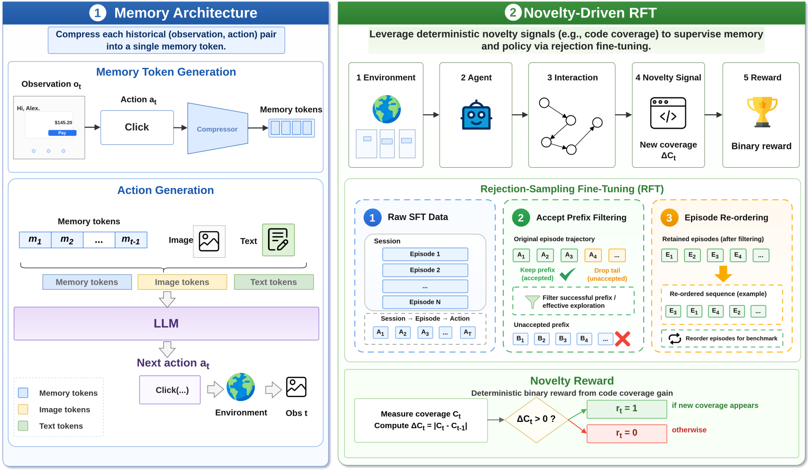
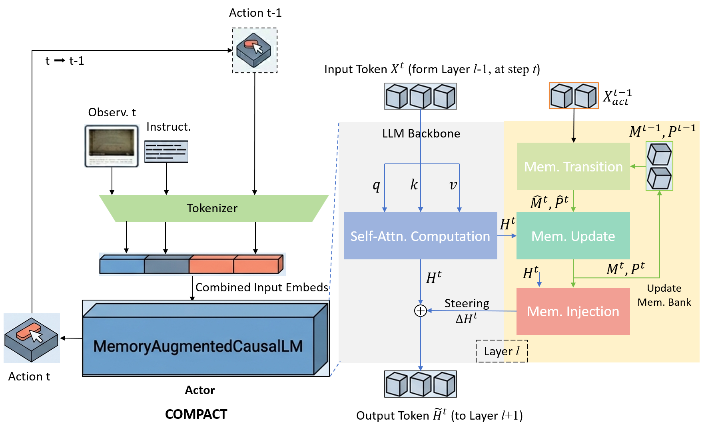
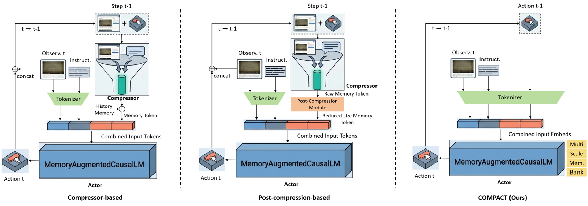

# JAMEL: Joint Agent Memory and Exploration Learning via Novelty Signals

[](https://arxiv.org/abs/2606.01528)
[](https://huggingface.co/BlitherBoom/JAMEL-9B)
[](https://huggingface.co)



> **Fork note:** this repository is [JAMEL](https://github.com/MobileLLM/JAMEL) plus
> **COMPACT** — a fixed-size, per-layer latent side memory that replaces JAMEL's textual
> memory inside the prompt. The environment and datasets are shared with original JAMEL.

This repository implements the core ideas of [Joint Agent Memory and Exploration Learning via Novelty Signals](https://arxiv.org/abs/2606.01528). In open-ended environments, agents often struggle to explore effectively, especially when external task rewards are sparse or unavailable. A central reason is that effective exploration requires memory. Without remembering what has already been tried, an agent can easily repeat exhausted behaviors instead of discovering new states.

The paper proposes **JAMEL** — **Joint Agent Memory and Exploration Learning** — a framework that trains agent memory and exploration policy together. Its main insight is that memory and exploration form a mutually reinforcing loop: memory helps the agent avoid repeated behaviors and identify unexplored actions, while novelty-driven exploration provides supervision for what the memory should encode. Instead of relying on manually annotated memory labels, JAMEL uses persistent novelty signals, such as JavaScript code coverage in GUI environments, as an intrinsic reward for discovering new behavior. Experiments on the [ScaleWoB](https://github.com/ScaleWoB/ScaleWoB) GUI benchmark show that JAMEL generalizes to unseen applications.

---

## JAMEL-COMPACT: compact side memory (this repo)

This repository extends the original JAMEL with **COMPACT** (`jamel_compact/`): instead of a
separate compressor that injects an aligned memory prefix into the actor, memory now lives in a
small, fixed-size latent state carried *inside* the model, layer by layer. The conda environment
and the datasets are **the same as original JAMEL** — nothing extra to install and nothing extra
to download. See [Quick Start](#quick-start) below, then jump to
[COMPACT training](#compact-training) / [COMPACT evaluation](#compact-evaluation).



### The idea

Original JAMEL keeps memory *outside* the actor: a separate Qwen3-VL compressor
(`jamel/arch/qwen3vl_compressor/`) turns (observation, action) history into memory
representations that are aligned and injected into the actor as an input prefix, and the SFT
data is pre-generated by running that compressor offline (`prepare_sft_dataset.py
--compressor-model ...`). COMPACT folds writer and reader into a *single* model: the same
Qwen3-VL weights maintain a **per-decoder-layer side memory**
$M_t \in \mathbb{R}^{N_m \times d_{mem}}$ ($N_m{=}16$, $d_{mem}{=}512$) plus a per-slot
variance $P_t$. The prompt at every step is only the instruction and the current screenshot,
while all history lives in $(M_t, P_t)$ — so the context length stays fixed however long the
session runs, and there is no second model to train or run.



Each layer runs the same four-stage cycle per environment step:

| Stage | What it does |
|---|---|
| **Predict** | Previous action $a_{t-1}$ is a control input: FiLM-modulates the memory and drives a GRU to predict $\hat M_t$; the variance prior inflates with previous surprise $e_{t-1}$. |
| **Observe** | The pretrained layer output is down-projected to $d_{mem}$ and pooled by $k{=}4$ learned latent queries over prompt/current-observation tokens only (padding and, during teacher forcing, response tokens are masked). |
| **Correct** | Kalman update with learned noise terms: $K = \hat P / (\hat P + R)$, $M_t = \hat M + K \odot \Delta M$, $P_t = (1-K)\hat P$. Gain is high when memory is uncertain or the observation is trustworthy. |
| **Inject** | Gated cross-attention read of $M_t$ back into the hidden state. The up-projection is **zero-initialized**, so the wrapped model is exactly the pretrained LLM at step 0 and grows into the memory. |

Three design choices make it work in practice:

- **Learned uncertainty instead of a pinned recursion.** v1's confidence $C$ was a fixed
  hyperparameter recursion with almost no gradient; v2's $K$ is a function of weights
  ($Q_\theta$, $R_\psi$) and is supervised by a Gaussian NLL, so it is trainable end-to-end
  and actually reacts to UI changes (surprise spike → $\hat P$ inflates → $K \approx 0.93$ →
  observation overwrites memory).
- **Training on whole session chunks.** Training uses ordered chunks of 8 consecutive steps
  (`chunk_size=8`) with full BPTT inside a chunk and detached $(M, P, e)$ carried across chunk
  boundaries — truncated BPTT matching the 50-step recurrent evaluation regime.
- **Memory-conditioned generation.** At eval time the memory-updated prompt states populate a
  KV cache and decoding continues from them, so the sampled action is actually conditioned on
  memory (v1 updated memory and then generated from the raw prompt, discarding it).

Losses: action cross-entropy (optionally weighted by coverage delta) + observation-prediction
MSE (the memory must anticipate what it will see) + Gaussian NLL on the surprise + a small L2
penalty on memory magnitude.

| Item | Value |
|---|---|
| Memory | $N_m{=}16$ tokens/layer, $d_{mem}{=}512$, learnable $M_0 \sim \mathcal{N}(0, 0.02^2)$ |
| Uncertainty | $P_0{=}0.5$; $\lambda_l$ init 0.70/0.85/0.95 (shallow→deep); $\gamma_e{=}1.0$; $R_{min}{=}0.01$ |
| Observation | $k{=}4$ latent queries, projected before attention |
| Injection | zero-init up-projection, learnable gate, layer weights 0.8/0.5/0.3 |
| Training | chunk 8 steps (TBPTT-8); $\lambda_{mem}{=}10^{-3}$; `--lambda-obs` / `--lambda-nll` default 0.01 (0.1 in the paper experiments) |
| Parameter overhead | +11.9% on Qwen3-VL-2B, +6.4% on Qwen3-VL-8B |

Full math and design notes: [docs/COMPACT_V2_METHOD.md](docs/COMPACT_V2_METHOD.md). Work order /
bug-fix rationale: [docs/COMPACT_V2_IMPLEMENTATION_PLAN.md](docs/COMPACT_V2_IMPLEMENTATION_PLAN.md).
Every command variant (baseline, LoRA, FSDP, ablations): [docs/COMPACT_COMMANDS.md](docs/COMPACT_COMMANDS.md).

### Brief demo

**1. Inspect the side memory without a GPU or model download** — prints the per-layer
parameter and memory-state breakdown for Qwen3-VL-2B and 8B shapes:

```bash
python examples/show_compact_params.py
```

**2. Roll the model forward as the evaluator does** — one prompt per step, with the memory
carried across steps (no context accumulation). This is a condensed sketch of the session loop
in [jamel_compact/eval.py](jamel_compact/eval.py), with `env` standing in for the ScaleWoB
browser environment:

```python
import torch
from PIL import Image
from jamel_compact import CompactConfig, JAMELCompactWrapper

cfg = CompactConfig(base_model_name="Qwen/Qwen3-VL-2B-Instruct")
model = JAMELCompactWrapper(cfg).eval().to("cuda")   # pretrained LLM + side memory
processor = model.processor                           # processor + tokenizer live on the wrapper
embed = model._get_input_embeddings()

memory_states, variance_states = model.init_memory(batch_size=1, device="cuda")
e_prev_list = None
last_action = "noop()"

for step in range(50):
    prompt, screenshot = env.observe()                 # instruction + current frame only
    image = Image.fromarray(screenshot).resize(cfg.image_resize)

    content = []
    segments = prompt.split("<image>")
    for idx, segment in enumerate(segments):
        if segment:
            content.append({"type": "text", "text": segment})
        if idx < len(segments) - 1:
            content.append({"type": "image"})
    messages = [{"role": "user", "content": content}]
    text = processor.apply_chat_template(
        messages, tokenize=False, add_generation_prompt=True,
    )
    inputs = processor(text=[text], images=[image], return_tensors="pt")
    inputs = {k: v.to("cuda") for k, v in inputs.items() if isinstance(v, torch.Tensor)}
    inputs.pop("second_per_grid_ts", None)

    # the previous action is the control input u_t of the memory transition
    act_ids = torch.tensor(
        [processor.tokenizer.encode(last_action, add_special_tokens=False)[:32]],
        device="cuda",
    )
    action_embed_input = embed(act_ids).mean(dim=1)                       # [1, d]

    out = model.generate(
        input_ids=inputs["input_ids"],
        attention_mask=inputs.get("attention_mask"),
        action_embed_input=action_embed_input,
        memory_states=memory_states,
        variance_states=variance_states,
        pixel_values=inputs.get("pixel_values"),
        image_grid_thw=inputs.get("image_grid_thw"),
        mm_token_type_ids=inputs.get("mm_token_type_ids"),
        e_prev_list=e_prev_list,
        max_new_tokens=256,
        temperature=0.8,
        top_p=0.9,
    )

    memory_states, variance_states = out["new_memory"], out["new_variance"]
    e_prev_list = out["e_list"]
    last_action = processor.tokenizer.decode(
        out["generated_ids"][0], skip_special_tokens=True,
    )
    env.step(last_action)
```

A single training step is the same call through `forward(..., labels=...)`, which additionally
returns `loss` / `loss_dict` and the per-layer `loss_obs` / `loss_nll` terms.

### COMPACT data and environment

No new environment and no new dataset: use the JAMEL conda/`uv` environment from
[Quick Start](#quick-start) and the same ExplorerSFT-ReAct trajectories used by original JAMEL.
The only difference is that COMPACT needs **no offline memory compression** — it concatenates
the trajectories, rebuilds the canonical prompts (same `build_web_prompt()` as eval) and splits
**complete sessions** into train/val so the recurrent chunks stay continuous:

```bash
INPUT=/path/to/ExplorerSFT-ReAct_Dataset/data \
OUTPUT_DIR=data/compact_sft_data_all \
VAL_RATIO=0.05 \
bash shell/run_compact_prepare_data.sh
# → data/compact_sft_data_all/compact_train.parquet
#   data/compact_sft_data_all/compact_val.parquet
```

Use the `.../data/react-vision` or `.../data/react-text` directory instead of `data` to train on
a single variant; `APPS=weibo,alipay` restricts to a few apps for a smoke test.

### COMPACT training

The pretrained backbone is frozen by default (`FREEZE_BASE=1`) and only the side memory (plus an
optional LoRA adapter) trains. `CHUNK_SIZE=8` is the v2 default and forces `BATCH_SIZE=1`
(one batch = one recurrent session chunk), so raise `GRAD_ACCUM` for a larger effective batch:

```bash
TRAIN_FILE=data/compact_sft_data_all/compact_train.parquet \
VAL_FILE=data/compact_sft_data_all/compact_val.parquet \
BASE_MODEL=Qwen/Qwen3-VL-2B-Instruct \
OUTPUT_DIR=outputs/compact_ckpt_v2 \
TB_LOG_DIR=outputs/compact_tb_v2 \
GPU_IDS=0 \
MEM_DIM=512 \
NUM_MEM=16 \
MAX_LENGTH=8192 \
MAX_EPOCHS=3 \
BATCH_SIZE=1 \
GRAD_ACCUM=16 \
LR=2e-5 \
MEMORY_LR=5e-6 \
FREEZE_BASE=1 \
CHUNK_SIZE=8 \
LOG_STEPS=10 \
SAVE_STEPS=500 \
VAL_STEPS=200 \
bash shell/run_compact_train.sh
# → outputs/compact_ckpt_v2/final
```

When calling `python -m jamel_compact.train` directly, pass `--chunk-size 8` explicitly — the
CLI default is `1` (v1 single-step behavior); the shell launcher above already sets it.

Monitor with `tensorboard --logdir outputs/compact_tb_v2`. Useful variants:
`MODEL_PARALLEL=1` to shard a frozen 8B model across `GPU_IDS`, `LORA_RANK=128 LORA_ALPHA=256`
for LoRA on top of the frozen base, `FREEZE_BASE=0 FSDP=1` for dense full SFT,
`COVERAGE_WEIGHT_ETA=0.5` to up-weight high-novelty samples, and
`LAMBDA_OBS` / `LAMBDA_NLL` to rebalance the auxiliary losses.

v2 changes the side-memory parameterization (`model_version: 2`), so **v1 COMPACT checkpoints
cannot be loaded** — retrain from the base model.

### COMPACT evaluation

```bash
CHECKPOINT=outputs/compact_ckpt_v2/final \
APPS_MODE=test10 \
SCALEWOB_ROOT=env/browser_env/scalewob-env \
MAX_STEPS=50 \
NUM_SESSIONS=3 \
EVAL_OUTPUT=outputs/compact_eval_v2 \
GPU_IDS=0 \
bash shell/run_compact_eval.sh
```

Swap `APPS_MODE=train86` for the sanity check or `APPS=weibo` for a single-app debug run.
Ablations: `FREEZE_MEMORY_INIT=1` never writes memory back (memory-on vs. memory-off),
`GAIN_MODE=fixed FIXED_GAIN=0.5` / `GAIN_MODE=zero` / `GAIN_MODE=one` override the learned
Kalman gain, and `SAVE_UNCERTAINTY=1` dumps the full $P_{t}$, $R_t$, $K_t$, surprise and write
magnitudes per step into each session's `trajectory_*.parquet` for analysis.

The pure-backbone reference (no side memory) uses `shell/run_baseline_train.sh` and
`shell/run_baseline_eval.sh` with the same data and the same ScaleWoB apps, so COMPACT is always
compared against an equal-budget baseline.

---

## Quick Start

Create and synchronize the local environment with `uv`:

```bash
git clone https://github.com/Mooncakebro/JAMEL-COMPACT.git
cd JAMEL-COMPACT

uv sync --locked --python 3.10 --extra dev --extra train
uv run playwright install chromium
source .venv/bin/activate
```

Install system fonts and the Node.js (18+) coverage tools used by browser evaluation:

```bash
sudo apt-get update
sudo apt-get install -y fontconfig fonts-noto-cjk fonts-noto-color-emoji
fc-cache -fv
npm install -g monocart-coverage-reports monocart-locator
```

Set local paths:

```bash
export JAMEL_ROOT=$PWD
export VERL_AGENT_ROOT=$PWD/third_party/verl-agent
export SCALEWOB_ROOT=$PWD/env/browser_env/scalewob-env
export PYTHONPATH=$JAMEL_ROOT:$VERL_AGENT_ROOT:${PYTHONPATH:-}
```

Download ScaleWoB benchmark:

```bash
python scripts/download_scalewob_env.py
```

You can preview the browser environment now:
```bash
python scripts/serve_scalewob.py
# Open http://127.0.0.1:8000/<app_name>/index.html to browse the benchmark. e.g., http://127.0.0.1:8000/expedia/index.html
```

For training dependencies, install:

```bash
uv pip install -r third_party/verl-agent/requirements.txt
```

### Training (original JAMEL pipeline)

The training entry point is [docs/TRAINING.md](docs/TRAINING.md). Prepare SFT data from trajectories, then train the actor. If `OUTPUT_MODEL_PATH` is set, the trainer packages the final JAMEL model for evaluation automatically.

```bash
python jamel/train/memory/prepare_sft_dataset.py \
  --input /path/to/trajectory.parquet \
  --output data/jamel_sft_data \
  --compressor-model /path/to/Qwen3-VL-2B-Instruct \
  --max-memory-items 512 \
  --max-length 8192 \
  --val-ratio 0.02 \
  --compression-batch-size 4

TRAIN_FILE=data/jamel_sft_data/jamel_memory_sft_train.parquet \
VAL_FILE=data/jamel_sft_data/jamel_memory_sft_val.parquet \
BASE_MODEL_PATH=Qwen/Qwen2.5-VL-7B-Instruct \
COMPRESSOR_MODEL=/path/to/Qwen3-VL-2B-Instruct \
OUTPUT_DIR=outputs/jamel_sft_ckpt \
OUTPUT_MODEL_PATH=outputs/jamel_model \
NPROC_PER_NODE=8 \
TOTAL_EPOCHS=2 \
VAL_STEPS=200 \
bash shell/run_qwen25vl_7b_sft.sh
```


### Evaluation (original JAMEL pipeline)

The evaluation entry point is [docs/EVALUATION.md](docs/EVALUATION.md). Run JAMEL evaluation on 10 test apps:

```bash
MODEL_PATH=/path/to/jamel_model \
APPS_MODE=test10 \
MAX_STEPS=50 \
NUM_SESSIONS=1 \
NUM_GPUS=4 \
WORKERS_PER_GPU=1 \
EVAL_OUTPUT=outputs/eval_test10 \
bash shell/run_eval.sh
```

For more details, please refer to [this document](docs/EVALUATION.md).

### Documentation

- [Training](docs/TRAINING.md)
- [Evaluation](docs/EVALUATION.md)
- [COMPACT method](docs/COMPACT_V2_METHOD.md)
- [COMPACT implementation plan](docs/COMPACT_V2_IMPLEMENTATION_PLAN.md)
- [COMPACT full commands](docs/COMPACT_COMMANDS.md)
